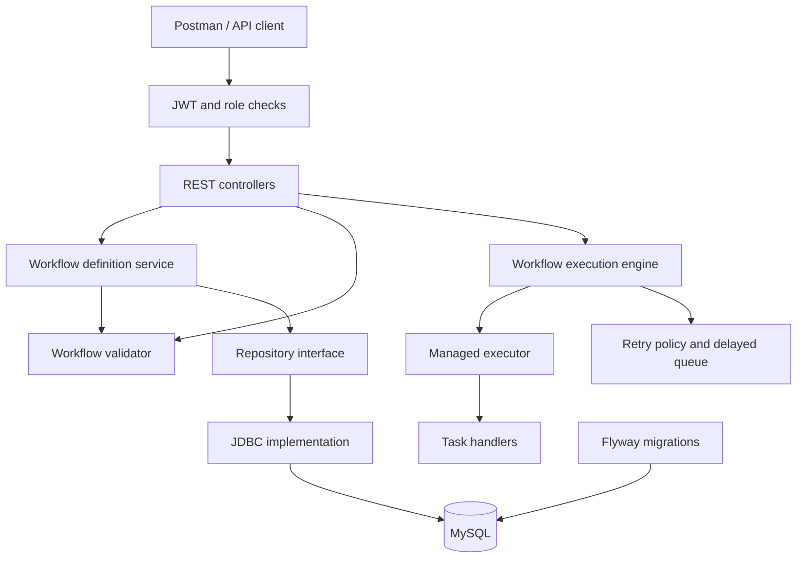
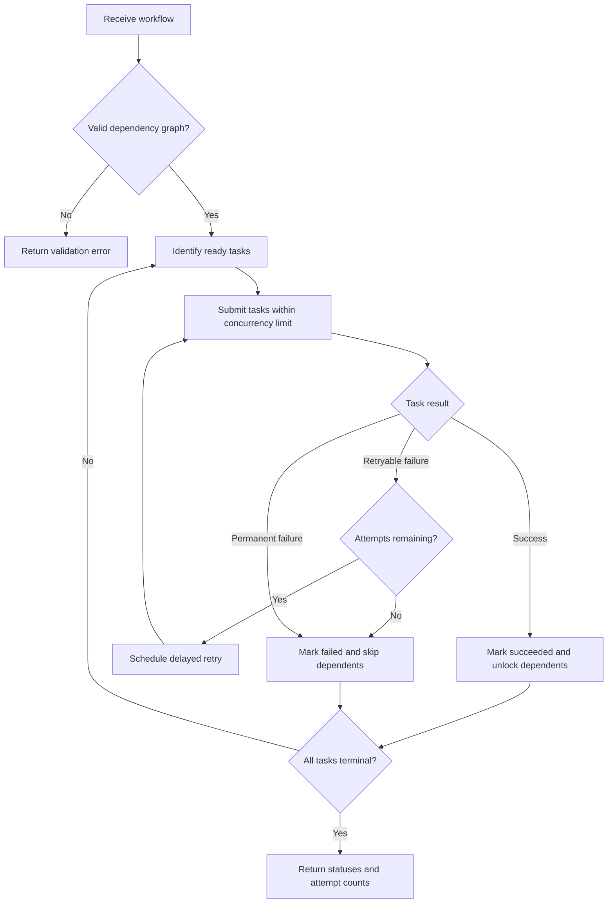
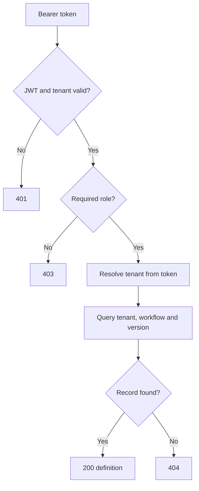

# TaskFlow — Multi-Tenant Workflow Orchestration Engine

A Java and Spring Boot workflow engine for validating task dependencies,
executing independent tasks concurrently, and retrying transient failures.

TaskFlow is a learning and portfolio project focused on backend engineering:
graph algorithms, Java concurrency, maintainable application design, REST APIs,
and relational persistence.

## Problem Statement

Business processes often contain tasks that must run in a specific order.
Some tasks can run independently, while others must wait for their dependencies.

A workflow engine must answer several questions:

- Are all referenced tasks present?
- Does the dependency graph contain a cycle?
- Which tasks can execute concurrently?
- What happens when a task fails?
- Which failures should be retried?
- How can workflow definitions be stored and retrieved reliably?

TaskFlow addresses these questions through dependency validation, bounded
concurrent execution, configurable retry policies, and versioned workflow
definition storage.

## Project identity and compatibility

The project directory, Maven artifact ID and Spring application name are `taskflow`.
The Java base package is `com.suyog.taskflow`; the entry point is
`com.suyog.taskflow.TaskflowApplication`.

The existing MySQL schemas/users, `FLOWFORGE_DB_PASSWORD` and
`FLOWFORGE_TEST_DB_PASSWORD` variables, Keycloak realm/client/audience, and
`flowforge.retry.*` / `flowforge.security.audience` configuration keys are
intentionally retained for compatibility. These are infrastructure/configuration
identifiers, not stale Java package references. No database migration or Keycloak
recreation is required for this rename.

See [REFACTORING.md](REFACTORING.md) for changes, validation limits, and Windows
installation steps. The earlier 64-test result below predates this archive's
refactoring; run the suite locally after installing this copy.

## Previous verified milestone

On 12 October 2026, the local suite passed **64 tests with zero failures, errors, or skips**. Live Postman checks confirmed reader GET 200, reader creation 403, cross-tenant GET 404, and unauthenticated GET 401. Security tests mock JWT decoding; live Keycloak checks complement them.

## Implemented Features

- Workflow validation for missing dependencies, duplicate task identifiers,
  self-dependencies, and circular dependencies.
- Topological ordering using Kahn’s algorithm.
- Concurrent execution of independent tasks using a Spring-managed executor.
- Dependency-aware scheduling: tasks run only after their dependencies succeed.
- Failure propagation: dependent tasks are skipped after an upstream failure,
  while independent branches can continue.
- Configurable exponential backoff for retryable task failures.
- Delayed retry scheduling using `DelayQueue`.
- Task status and attempt counts in execution results.
- REST endpoints for validation and execution previews.
- MySQL schema management with Flyway.
- Transactional workflow definition creation and tenant-scoped version retrieval.
- Keycloak JWT signature, issuer, timestamp, audience and tenant validation.
- Independent `workflow-read` and `workflow-write` realm-role permissions.
- Postman browser login using authorization code with PKCE S256.
- Automated tests for validation, execution, retries, REST behavior, and
  database integration.

Execution previews currently use mock task handlers. They do not perform real
payments or call external business services.

## Technology Stack

| Area | Technology |
|---|---|
| Language | Java 21 |
| Backend | Spring Boot |
| Security | Spring Security OAuth2 Resource Server, standalone Keycloak |
| REST APIs | Spring MVC, Jakarta Bean Validation |
| Concurrency | ExecutorService, CompletionService, DelayQueue |
| Persistence | MySQL, Spring JDBC |
| Schema migrations | Flyway |
| Testing | JUnit, Spring Boot Test, MockMvc |
| Build | Maven Wrapper |
| Manual API testing | Postman |

## Architecture

TaskFlow is structured as a modular monolith with responsibilities separated
between the API, application, domain, and persistence layers.



Stored-definition endpoints use the authenticated tenant from `CurrentTenant`. The service calls the JDBC repository with that tenant. Preview execution remains in memory and accepts a submitted definition; executing a stored version is the next milestone.

## Execution Flow



## Algorithms and Data Structures

| Component | Purpose |
|---|---|
| Directed dependency graph | Models relationships between workflow tasks |
| Adjacency lists | Track downstream dependent tasks |
| In-degree map | Counts unresolved dependencies |
| ArrayDeque | Holds tasks ready for topological processing |
| Maps | Provide task lookup and track statuses and attempts |
| DelayQueue | Holds retries until their scheduled execution time |

Dependency validation and topological ordering run in **O(V + E)** time,
where V is the number of tasks and E is the number of dependency edges.

## Design Decisions

- **Strategy pattern:** retry behavior is expressed through a retry policy
  interface.
- **Repository pattern:** workflow persistence is accessed through an
  interface, separating application logic from database access.
- **Dependency injection:** Spring manages services and shared infrastructure.
- **Immutable domain records:** workflow definitions are represented using
  records and defensive collection copies.
- **Coordinator-owned execution state:** scheduling decisions and workflow
  state updates are coordinated centrally.
- **Bounded concurrency:** a managed thread pool limits simultaneous task
  execution.
- **Delayed retry scheduling:** workers do not sleep during retry backoff.

## Local Setup

### Requirements

- JDK 21
- MySQL running locally
- Git
- PowerShell or another terminal

Maven is available through the included Maven Wrapper.

### Database Configuration

Create the application and test databases:

- `flowforge`
- `flowforge_test`

Configure local database accounts with access to their respective databases.
The local migration account needs permission to apply the Flyway migrations.

Application database credentials are configured through:

- Username: `flowforge_app`
- Password environment variable: `FLOWFORGE_DB_PASSWORD`

Test database credentials are configured through:

- Username: `flowforge_test_app`
- Password environment variable: `FLOWFORGE_TEST_DB_PASSWORD`

Set the environment variables in the terminal or IntelliJ run configuration.
Do not commit real credentials.

Review these files for local connection settings:

- `src/main/resources/application.properties`
- `src/test/resources/application-test.properties`

Flyway applies database migrations during application startup.
The database and user accounts must already exist.

### Run Tests

From the project root:

```powershell
.\mvnw.cmd clean test
```

Database integration tests require the test database and its credentials.

### Start the Application

```powershell
.\mvnw.cmd spring-boot:run
```

Default application URL:

```text
http://localhost:8082
```

Health endpoint:

```http
GET http://localhost:8082/actuator/health
```

## Authentication and permissions

Start standalone Keycloak from its installation directory:

```cmd
bin\kc.bat start-dev --http-port=8081
```

Create realm `flowforge` and public OIDC client `flowforge-postman`. Set client authentication Off, Standard flow On, Direct access grants Off, Require PKCE On and PKCE Method S256. Register the exact callback displayed by Postman; do not use a wildcard.

Define the single-valued user attribute `tenant_id` with Admin-only edit/view permissions and no default. Assign Tenant A `11111111-1111-4111-8111-111111111111` and Tenant B `22222222-2222-4222-8222-222222222222`.

In the client's dedicated scope, add a User Attribute mapper from `tenant_id` to the String access-token claim `tenant_id`, with multivalued Off. Add an Audience mapper with custom audience `flowforge-api`. Keep the default roles scope and permit the application roles in any restricted role scope mappings.

Create independent realm roles `workflow-read` and `workflow-write`. Assign both to `tenant-a-user` and `tenant-b-user`. Assign only read to `tenant-a-reader`, who belongs to Tenant A. Set local user passwords without committing them.

In Postman use OAuth 2.0, Authorization Code with PKCE, browser login, S256, scope `openid`, client ID `flowforge-postman` and no client secret. URLs:

- Authorization: `http://localhost:8081/realms/flowforge/protocol/openid-connect/auth`
- Token: `http://localhost:8081/realms/flowforge/protocol/openid-connect/token`

Obtain fresh tokens after role changes. Login as the intended user, not merely with a different token label. `/api/me` returns the user's subject and tenant. Tokens are sent through `Authorization: Bearer <access-token>`.

| Endpoint | Permission |
|---|---|
| GET /actuator/health | Public |
| GET /api/me | Valid authenticated tenant token |
| POST /api/workflows | workflow-write |
| GET /api/workflows/{workflowId}/versions/{version} | workflow-read |
| POST /api/workflows/validate | workflow-write |
| POST /api/workflows/execute-preview | workflow-write |



### Create and retrieve a stored definition

Send the example JSON below to `POST /api/workflows` with a writer token and `Content-Type: application/json`. Expect 201 and a Location header. Save the returned `workflowId`, not `versionId`. Retrieve it using `GET /api/workflows/{workflowId}/versions/1` with a read-authorized token from the same tenant.

Creation stores the definition without executing it. Repeated POSTs create new workflows; creation is not idempotent. A caller-supplied tenant header cannot change ownership. Foreign-tenant and missing records both return 404.

## API Examples

### Validate a Workflow

```http
POST http://localhost:8082/api/workflows/validate
Authorization: Bearer <access-token>
Content-Type: application/json
```

```json
{
  "name": "settlement-preview",
  "tasks": [
    {
      "id": "payments",
      "type": "MOCK_SUCCESS",
      "dependsOn": []
    },
    {
      "id": "reconcile",
      "type": "MOCK_SUCCESS",
      "dependsOn": ["payments"]
    },
    {
      "id": "settlements",
      "type": "MOCK_SUCCESS",
      "dependsOn": ["reconcile"]
    }
  ]
}
```

### Execute a Preview

Send the same JSON body to:

```http
POST http://localhost:8082/api/workflows/execute-preview
Authorization: Bearer <access-token>
Content-Type: application/json
```

The response includes the workflow name, overall success, task statuses,
and execution attempt counts.

### Available Mock Task Types

| Type | Behavior |
|---|---|
| `MOCK_SUCCESS` | Succeeds |
| `MOCK_FAILURE` | Fails without retry |
| `MOCK_RETRYABLE_FAILURE` | Continues failing until retry attempts are exhausted |
| `MOCK_RETRY_THEN_SUCCESS` | Fails on the first two attempts and succeeds on the third |

## Testing Approach

Automated tests cover:

- Valid and invalid dependency graphs.
- Missing tasks, duplicate identifiers, and circular dependencies.
- Dependency-aware execution and concurrent independent tasks.
- Failure propagation and skipped dependent tasks.
- Retry limits and eventual success.
- REST request validation and error responses.
- Application context and database migration checks.

Postman also verifies live Keycloak login, definition creation, same-tenant reader access, reader write denial, cross-tenant isolation and unauthenticated rejection. Database/API integration tests require the separate test schema and credentials.

## Current Scope and Limitations

- Execution previews run in memory.
- Execution state is not recovered after an application restart.
- Only one preview is admitted across all tenants per application instance; competing requests receive 429.
- Task handlers simulate outcomes.
- Authorization is enforced at the HTTP layer; service methods receive an explicit tenant.
- No task timeout or user cancellation endpoint is implemented.
- No persisted runs, restart recovery, creation idempotency or additional-version API is implemented.
- This is a local development project, not a production workflow platform.

## Roadmap

- Execute a stored workflow version using tenant-scoped lookup.
- Add task deadlines, cancellation and tenant-aware admission.
- Persistent execution history.
- Additional operational controls and observability.
- CI automation for build and test verification.